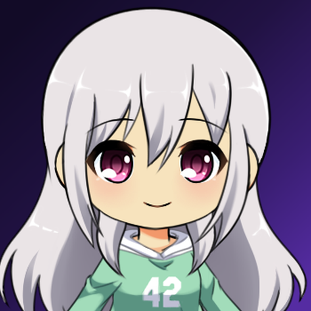
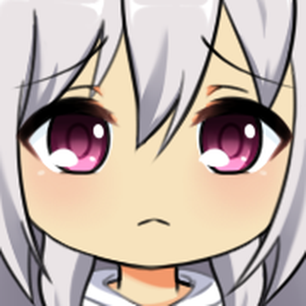

# Notification Character Assets

Renders flattened PNG portraits of the notification character from the layers of a third-party chibi
PSD. Every pixel comes from the PSD or from a gradient in the config, without generative AI. The PNGs in
`Examples/` only document the workflow. The notification images the app ships are generated from
`notification-scenarios.json` (see [Notification scenarios](#notification-scenarios)).

<p>
  
  
</p>

```text
Source/chibis_600x400.psd   unmodified upstream artwork; provenance and terms in Source/README.md
characters.json             all choices: layer map, backgrounds, crops, characters, examples
render_character.py         the renderer
notification-scenarios.json every notification state: art, title, copy (source of truth for the app)
notification_scenarios.py   validates the scenarios and generates the data set and docs (standard library only)
requirements.txt            pinned psd-tools, Pillow, numpy
Examples/                   committed renders that --check keeps honest
```

## Render a portrait

```bash
make notification-character                           # rewrite the example PNGs and the app's notification assets
make notification-character CHARACTER_ARGS=--list     # valid characters, crops, backgrounds, layer choices
make notification-character CHARACTER_ARGS="--character canonical --crop close-up"
make notification-character-check                     # everything still matches the PSD and config, plus the unit tests
```

The first run builds a venv at `build/notification-character/venv` (ignored by git) from the pinned
`requirements.txt`. Output goes to `build/notification-character/<character>-<crop>.png` unless you pass
`--out`. Run the script directly with that venv's `python` to pass any flags.

Each PNG is 8-bit RGB with an sRGB chunk, no alpha, and no other metadata. The same pins always give the same
pixels. If you bump Pillow or psd-tools, run `make notification-character`, review the changed examples,
and commit them with the new pins.

## How the renderer builds an image

1. Checks the PSD against the SHA-256 in `characters.json`.
2. Resolves the character (following `extends`) to PSD layer **paths**, such as `hair back/long/silver`.
   Layer names repeat across groups, so paths are the identity and layer numbers are never used.
3. Ignores the visibility saved in the PSD. It turns every group on and only the chosen layers on.
4. Composites the crop box from the PSD, which has no background layer, onto the named background,
   then resizes to the crop's output size with Lanczos. It flattens before resizing so no edge fringes.

## Source layers and the layer map

`layerMap` in `characters.json` turns a slot into a path. A slot value fills the template's
`{placeholders}`: a string fills `{name}`, an object fills the named fields, a list picks several layers,
and `null` or `[]` turns the slot off. `--list` prints the valid values for each slot.

| Slot | Template | PSD choices |
|---|---|---|
| `hairBack` | `hair back/{style}/{color}` | styles `short`, `twintails`, `long`, `hime`; colors `black`, `brown`, `pink`, `silver`, `blonde` |
| `hairFront` | `hair front/{style}/{color}` | styles `short`, `long`, `hime`, `bob`; the same five colors |
| `expression` | `face/{name}` | `smile`, `smile2`, `normal`, `laugh`, `delighted`, `sad`, `angry`, `annoyed`, `smug`, `sleepy`, `shocked` |
| `skin` | `body/{name}` | `skin1`, `skin2`, `skin3` |
| `blush` | `body/blush/{name}` | `blush1`, `blush2` (match the blush to the skin) |
| `outfit` | `outfit/{name}` | `seifuku`, `seifuku2`, `sundress`, `towel`, `swimsuit`, `hoodie`, `pe uniform`, `coat`, `pjs` |
| `accessories` | `accessories/{name}` | `choker`, `flower`, `red glasses`, `black glasses`, `circle glasses`; `[]` is off |

Hair styles differ between back and front: `twintails` exists only for the back and `bob` only for the front,
so a character can pair them with any style from the other group. The `hoodie` is a baked-in mint green
with a "42" print, so the outfit colors cannot be changed here.

The PSD's layers are all normal-blend at 100% opacity with no masks, effects, or clipping, so plain alpha
compositing is all the renderer needs.

## Create a character variant

Add an entry under `characters` in `characters.json`. Name only what differs from another character:

```json
"canonical-glasses": {
  "extends": "canonical",
  "accessories": ["red glasses"],
  "expression": "smug"
}
```

A character with no `extends` must set every slot in `layerMap` plus `background`. Unknown settings and
unknown layer paths are errors, and the message lists the valid choices. Then render it:

```bash
make notification-character CHARACTER_ARGS="--character canonical-glasses --crop head-and-shoulders"
```

To keep it as a documented example, add it to `examples` and run `make notification-character`. The new
PNG belongs in `Examples/`. Production assets belong in the app's asset catalog in a later change, not here.

## Crops and backgrounds

- **Crops** are square boxes `[x, y, width, height]` in the PSD's 400×600 pixels, plus an output `size`.
  `head-and-shoulders` frames the head and top of the hoodie at about a 1.5× upscale. `close-up` frames the eyes, cheeks,
  and mouth at about 2.8×, tighter for emotional expressions. The source is small, so large crops look soft by design.
- **Backgrounds** are a `solid` color or a `linear-gradient` with `from` and `to` in 0–1 crop coordinates and
  ascending `stops`. `fmp-dark-purple` reuses the app icon's base gradient (`Design/AppIcon/README.md`).
  `fmp-app-dark` is the app's `#0E0B16` background color.

## Notification scenarios

`notification-scenarios.json` describes every state the notification character can be in: its art
(`expression`, `outfit`, `crop`), a short title, interchangeable copy lines, and sample numbers for the
developer preview. It is the single source of truth. `make notification-character` generates from it:

- `PostureAnalysisApp/Assets.xcassets/NotificationCharacter/<expression>-<outfit>-<crop>.imageset`, one 512×512
  image per distinct art entry plus every expression in both crops in the hoodie (27 images, about 5 MB).
  `portrait` is the `head-and-shoulders` crop and `close` is `close-up`. Outfit names map to PSD layers in the
  file's `outfits` table.
- `PostureAnalysisApp/Assets.xcassets/NotificationScenarios.dataset`, the copy of the JSON the app loads.
- [`docs/notification-scenarios.md`](../../docs/notification-scenarios.md), a readable table of every scenario.

Never edit those generated files by hand. `--check` and the unit tests fail when they are stale. To change
copy or art, edit the JSON, run `make notification-character`, and commit the JSON with the regenerated files.
To add a scenario, add an entry with a unique kebab-case `id`, a `kind` (`nudge` or `acknowledgment`), the art
and copy, and a `sample` for any `{token}` it uses (`streak`, `record`, `remaining`, `days`; `{suggestion}`
needs no sample). Validation rejects unknown tokens, missing samples, unknown outfits, overlong lines, and
fewer copy lines than art entries (otherwise an alternate image could never be previewed).

## Tests

`scripts/tests/test_notification_character.py` validates the config, the PSD hash, and the committed
examples' PNG structure with only the standard library, so `./scripts/validate.sh` and CI run them.
The render tests need the venv's packages and skip without them. `make notification-character-check` runs everything.
`scripts/tests/test_notification_scenarios.py` does the same for the scenarios: schema validation, the generated data
set, docs and image metadata run everywhere, and the pixel comparison of all 27 images needs the venv.

## Persona content

`persona-content.json` is the source of truth for the app's persona copy library: its nine tones, sample values for
tokens, familiarity variants, content entries, and art choices. `persona_content.py` validates that file with only the
Python standard library. The renderer checks persona art against the PSD's expression choices and the outfit and crop
keys in `notification-scenarios.json`.

`make notification-character` generates `PostureAnalysisApp/Assets.xcassets/PersonaContent.dataset` and
[`docs/persona-content.md`](../../docs/persona-content.md). Persona portraits share the `NotificationCharacter`
asset catalog with scenario portraits; the renderer and `--check` use the deduplicated union so an image used by either
source remains available. `make notification-character-check` checks the generated files and rendered pixels.
